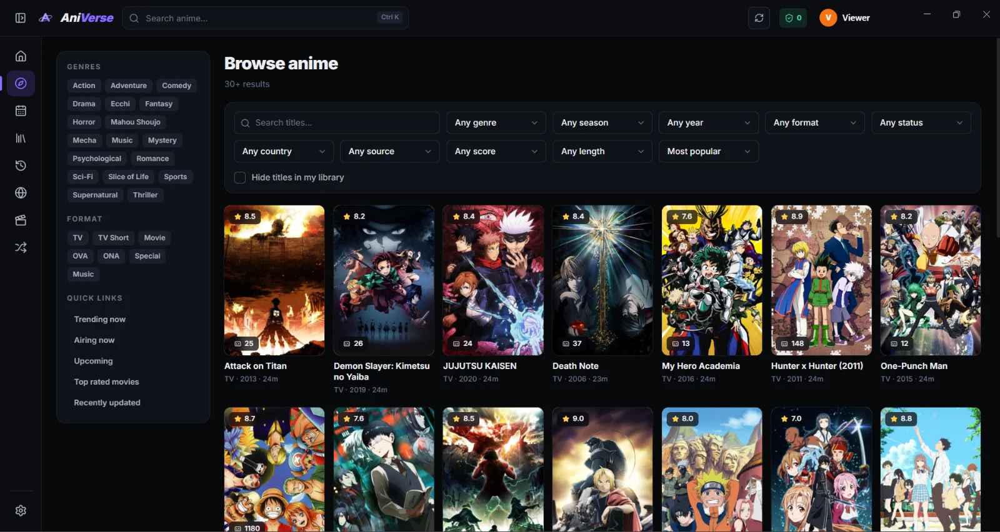
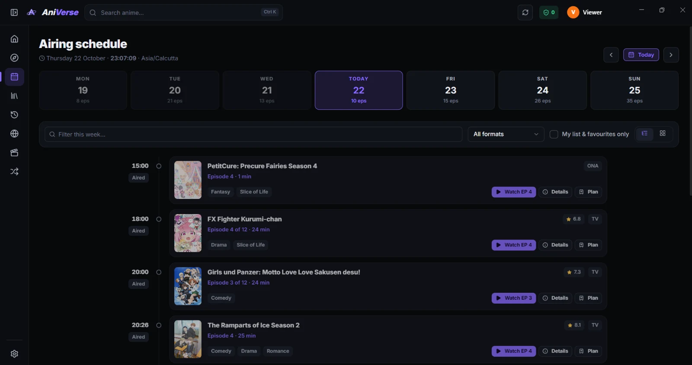
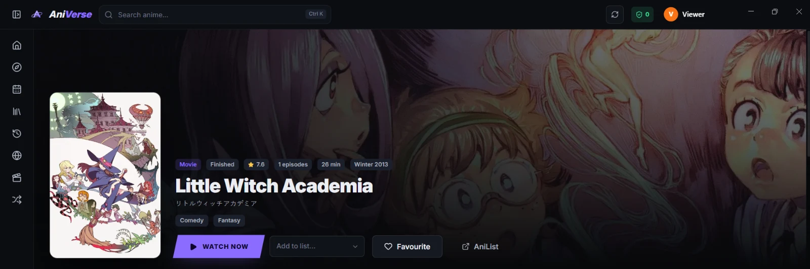
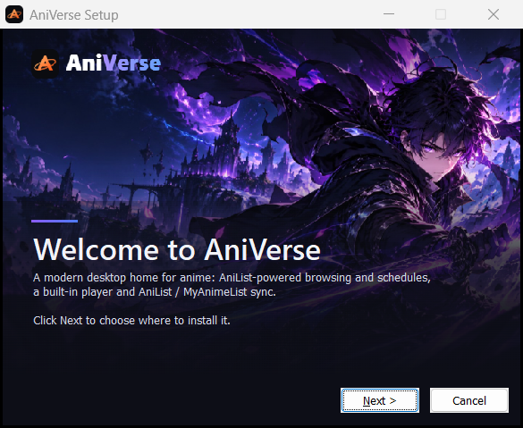

> [!CAUTION]
> ### 🚫 AniVerse hosts NOTHING — it is a web browser
> - **No content is hosted, uploaded, stored, streamed or distributed** by AniVerse or its developer. The developer runs **no media servers**.
> - AniVerse ships with **no websites**. **You** add the sites, and their pages and videos load **directly from those sites' own servers**.
> - AniVerse only works on pages a site has already sent: it finds episodes (web scraping and automated navigation), blocks ads, and shows **only the site's own player** through a CSS overlay. It **does not** download, rip or re-host videos, and it bypasses **no DRM**.
> - ⚖️ **DMCA takedown requests and other legal notices must go to the operator or hosting provider of the website that serves the content — NOT to AniVerse or its developer.**
>
> 📜 Full text: **[DISCLAIMER.md](DISCLAIMER.md)** · [DMCA disclaimer](#%EF%B8%8F-dmca-disclaimer)

<div align="center">


# AniVerse

**A cinematic desktop home for anime — browse, track, schedule and watch in one dark, fast app.**

AniList-powered discovery · airing schedule · built-in player · AniList & MyAnimeList sync

<p>
  <a href="LICENSE"></a>
  
  
  
  
</p>
<p>
  <a href="https://github.com/shiwamshoryasharma/AniVerse/stargazers"></a>
  <a href="https://github.com/shiwamshoryasharma/AniVerse/commits/main"></a>
  <a href="https://github.com/shiwamshoryasharma/AniVerse/issues"></a>
  
</p>

[Features](#-features) · [Screenshots](#-screenshots) · [How to use](#-how-to-use) · [Disclaimer](#%EF%B8%8F-disclaimer) · [Build from source](#%EF%B8%8F-build-from-source) · [Docs](#-documentation)

</div>

<br />


## ✨ Features

<table>
<tr>
<td width="50%" valign="top">

### 🏠 Discover
- **Home** — spotlight hero, *Latest episodes* grid (refreshes every 5 min, NEW badges, filters, paging), top charts, Continue watching, seasonal rails
- **Coming soon** — titles that aren't out yet, films still in cinemas and unaired episodes open a **release page with a live countdown** instead of a player
- **Browse** — full filter page (genres in/out, season, year, format, status, country, source, score, length, sort, hide-library) and instant search <kbd>Ctrl</kbd> <kbd>K</kbd>
- **Details** — banner, synopsis, episode grid with watched state, characters & cast, relations, recommendations, official streaming links, list status, score, favourite

</td>
<td width="50%" valign="top">

### 📅 Schedule
- Week strip with per-day counts, live clock and your timezone
- Timeline with a live “now” line and countdowns, or a grid view
- Filter box, format filter, *my list & favourites only*
- Hover details plus **Watch** and **Plan** buttons on every slot

### 👤 Profile
- Display name, bio, avatar and banner with drag-and-zoom crop
- Watch stats and favourites

</td>
</tr>
<tr>
<td valign="top">

### ▶️ Watch
- Open an episode from a site **you** added: AniVerse goes from the site's search to the series and the episode behind a running-cat loader. **Only the site's own player is shown.**
- **SUB / DUB and server switches** mirrored as AniVerse buttons, remembered per site
- Episode panel (list/grid, ranges, search, hide watched), prev/next, auto-next, skip-opening, theater, lights-off, mark watched, page pinning
- **Native player** for direct HLS / DASH / MP4 links and local files: quality & subtitle menus, speed, PiP, resume, **Chromecast / Google TV casting**
- Official YouTube channels as episode sources

</td>
<td valign="top">

### 🔄 Sync & community
- **Connect AniList and MyAnimeList** in your browser — no keys or tokens to paste
- Status, progress, scores and favourites sync automatically and offline-safe; optional **two-way sync** (newest edit wins, removals respected)
- **Unified comments** from AniList episode threads (read + post), MyAnimeList forum topics and YouTube, with Markdown/BBCode rendered safely

### 🛡️ Privacy & polish
- Ad, tracker and popup blocking (EasyList, EasyPrivacy, annoyance lists + your own rules)
- Each website runs in its **own isolated session**; nothing is shared between sites
- Accent themes (Ember, Aqua, Violet, Sakura, Crimson), density and title-language options

</td>
</tr>
</table>

## 📸 Screenshots

<table>
<tr>
<td width="50%"><p align="center"><sub><b>Browse</b> — every AniList filter in one place</sub></p></td>
<td width="50%"><p align="center"><sub><b>Schedule</b> — this week's episodes in your timezone</sub></p></td>
</tr>
<tr>
<td width="50%"><p align="center"><sub><b>Details</b> — list status, favourite and Watch now</sub></p></td>
<td width="50%"><p align="center"><sub><b>Installer</b> — themed, per-user, no admin rights</sub></p></td>
</tr>
</table>

## 🚀 How to use

### 1. Install

Build the Windows installer as described in [Build from source](#%EF%B8%8F-build-from-source) and run `AniVerse-Setup-<version>.exe`:

- pick any folder on any drive (no administrator rights needed);
- choose the desktop / Start Menu shortcuts;
- launch AniVerse from the finish page.

Upgrading or uninstalling keeps your library, settings and connected accounts.

### 2. Add your sources

AniVerse ships with **no websites**. Open **Settings → Sources → Edit streaming-sites.txt** and add one URL per line:

```text
# Official channels: episodes come from the channel and play in YouTube's embed
https://www.youtube.com/@SomeOfficialChannel

# Any other URL opens as an isolated, ad-blocked browser session
https://example-site.tld/
```

Save the file and the list reloads by itself. You are responsible for the sites you add (see the [Disclaimer](DISCLAIMER.md)).

### 3. Find something to watch

Use **Home**, **Browse**, **Schedule** or the search bar (<kbd>Ctrl</kbd> <kbd>K</kbd>). Right-click any card for quick actions: watch, plan, favourite, copy, or open on AniList.

### 4. Watch

Press **Watch now** and pick a source. On a website source, AniVerse finds the episode on that site for you and shows only its player. **SUB / DUB** and server buttons appear above it. Not out yet? You get the release date and a countdown instead.

| Native player key | Action |
| --- | --- |
| <kbd>Space</kbd> / <kbd>K</kbd> | Play / pause |
| <kbd>←</kbd> <kbd>→</kbd> · <kbd>J</kbd> <kbd>L</kbd> | Seek 5 s · seek by your step |
| <kbd>↑</kbd> <kbd>↓</kbd> · <kbd>M</kbd> | Volume · mute |
| <kbd>F</kbd> · <kbd>T</kbd> | Fullscreen · theater |
| <kbd>S</kbd> | Skip opening |
| <kbd>Shift</kbd>+<kbd>N</kbd> / <kbd>Shift</kbd>+<kbd>P</kbd> | Next / previous episode |
| <kbd>&lt;</kbd> <kbd>&gt;</kbd> · <kbd>0</kbd>–<kbd>9</kbd> | Speed · jump to 0–90 % |

App-wide: <kbd>F5</kbd> refresh, <kbd>Alt</kbd>+<kbd>←</kbd> / <kbd>→</kbd> back / forward.

### 5. Connect AniList / MyAnimeList

**Settings → Accounts & sync → Connect**:

1. Sign in on the service's own page in your browser and allow access.
2. When the browser asks *“Open AniVerse?”*, accept. You're connected.

Your list then syncs automatically. **Sync now** pulls changes on demand, and **Two-way sync** also brings edits made on the websites back into AniVerse.

### 6. Your data

Everything lives on your PC in `%APPDATA%\AniVerse`:
- the library, history and settings (SQLite);
- sign-ins, encrypted with Windows DPAPI.

Nothing is sent anywhere except to the services you use. See [PRIVACY.md](PRIVACY.md).

## ⚠️ Disclaimer

> [!IMPORTANT]
> **AniVerse is a browser with custom features — nothing more.**
> - It **hosts no content** and runs no media servers. Every website is a third-party site that the user adds; its pages and videos load **directly from that site's own servers**.
> - AniVerse reads those pages to find search results and episode links (web scraping and automated navigation), blocks ads, and lays a **CSS overlay** on top so only the site's own player shows. It does **not** download, copy, re-host or extract videos, and it bypasses **no DRM or access controls**.
> - The developer has **no control over, affiliation with, or responsibility for** those websites. **Send DMCA and other legal notices to the operator or hosting provider of the site that serves the content.**
> - AniVerse is not affiliated with AniList, MyAnimeList, YouTube or Google. Anime titles, artwork and metadata belong to their respective owners and are provided by AniList's public API.
> - You are responsible for the websites you add and for following the laws of your country.
>
> Full text: **[DISCLAIMER.md](DISCLAIMER.md)**. The software comes **without any warranty** (GPL-3.0, sections 15–16).

## 📚 Documentation

| Document | What's inside |
| --- | --- |
| [docs/ARCHITECTURE.md](docs/ARCHITECTURE.md) | Module map, data flow, security model |
| [docs/ACCOUNTS.md](docs/ACCOUNTS.md) | AniList / MyAnimeList sign-in, client IDs, redirect URLs, sync rules |
| [docs/INSTALLER.md](docs/INSTALLER.md) | Windows installer pages, behaviour, build and tests |
| [DISCLAIMER.md](DISCLAIMER.md) · [PRIVACY.md](PRIVACY.md) | Legal notice and what data goes where |
| [CONTRIBUTING.md](CONTRIBUTING.md) · [CODE_OF_CONDUCT.md](CODE_OF_CONDUCT.md) · [SECURITY.md](SECURITY.md) | How to help, community rules, reporting vulnerabilities |

## 🤝 Contributing

Bug reports, ideas and pull requests are welcome. Please read [CONTRIBUTING.md](CONTRIBUTING.md) first.

**Do not post links to, or lists of, unlicensed streaming websites** in issues, discussions or pull requests. They will be removed.

## 🛠️ Build from source

**Requirements:** Windows 10/11, [Node.js](https://nodejs.org) 22 or newer, npm, Git. There are no native modules to compile: storage uses Electron's built-in `node:sqlite`.

```bash
git clone https://github.com/shiwamshoryasharma/AniVerse.git
```

```bash
cd AniVerse
```

```bash
npm install
```

**Optional: AniList / MyAnimeList sign-in.** Register your own OAuth apps. Then copy `config/oauth.example.json` to `config/oauth.json` and put in your **client IDs**. Never put a secret there. [docs/ACCOUNTS.md](docs/ACCOUNTS.md) walks through it. Without client IDs, everything else works and the Connect buttons stay disabled.

**Run in development** (hot reload for the UI, auto-restart for the main process):

```bash
npm run dev
```

**Build and run the production bundle:**

```bash
npm run build
```

```bash
npm start
```

**Create the Windows installer** (`release/AniVerse-Setup-<version>.exe`):

```bash
npm run dist:installer
```

> [!NOTE]
> `dist` and `dist:installer` copy `config/streaming-sites.txt` from your checkout as the default source list. **Official releases** are built with `npm run dist:signed`. That build ships no source list and is signed with the certificate whose [fingerprints](#-certificate-fingerprints) are listed below. It needs that certificate in your Windows certificate store, so forks should use `dist:installer` or their own certificate (`ANIVERSE_SIGN_SHA1`).

<details>
<summary><b>All scripts</b></summary>

| Command | Purpose |
| --- | --- |
| `npm run dev` | Development app with HMR |
| `npm run build` | Bundle main/preload (esbuild) and renderer (Vite) into `dist/` |
| `npm start` | Run the built app |
| `npm run typecheck` | TypeScript for core/Electron and renderer |
| `npm run lint` | oxlint (React + TypeScript rules) |
| `npm test` | Unit tests (Vitest) |
| `npm run test:e2e` | Launch the built app hidden and screenshot every screen |
| `npm run test:live` | Live checks: AniList filters, YouTube RSS, optional site checks |
| `npm run test:sites` | Drive every configured website to an episode and report per site |
| `npm run dist` | Windows installer + portable build in `release/` |
| `npm run dist:installer` | Windows installer only |
| `npm run dist:signed` | Release installer: signed, no bundled source list |

</details>

<details>
<summary><b>Project layout</b></summary>

```text
app/shared      Types + typed RPC contract shared by every layer
app/core        Framework-free core: config parser, SQLite store, AniList client,
                source adapters (web, YouTube), comments, AniList/MAL sync
electron/       Main process: window, sessions & navigation policy, ad blocking,
                Cloudflare verifier, OAuth, deep links, media probe, IPC
frontend/       React renderer (pages, components, player, styles)
config/         filters.txt, oauth.example.json (your streaming-sites.txt and oauth.json stay local)
build/          App icon and the NSIS installer script
scripts/        Build/dev runners, installer art, asset importers
test/           Unit tests, fixtures, e2e drivers
docs/           Architecture, accounts, installer, screenshots
```

</details>

<div align="center">

## 🔏 Certificate fingerprints

</div>

Official AniVerse installers are signed with the developer's code-signing certificate (`CN=Shiwam Shorya Sharma, O=AniVerse`). Before you run an installer, check that its signature matches these fingerprints:

**SHA-1**
```text
5A:AD:69:1D:2F:1B:3C:A4:80:BA:10:83:D4:17:E7:2D:FA:9F:2B:84
```

**SHA-256**
```text
A4:E9:77:36:B3:50:B8:DB:5D:71:A7:A6:0B:D2:AA:94:BE:AA:8D:70:FB:0F:19:E2:27:D9:BF:3C:36:81:41:45
```

<details>
<summary><b>How to check</b></summary>

**In Explorer:** right-click the installer → **Properties** → **Digital Signatures** → select the signature → **Details** → **View Certificate** → **Details** → **Thumbprint**. It must equal the SHA-1 above.

**In PowerShell** (prints both fingerprints):

```powershell
$c = (Get-AuthenticodeSignature .\AniVerse-Setup-0.1.0.exe).SignerCertificate; ($c.Thumbprint -split '(..)' -ne '') -join ':'; ([BitConverter]::ToString([Security.Cryptography.SHA256]::Create().ComputeHash($c.RawData))).Replace('-', ':')
```

The certificate is self-signed, so Windows reports the publisher as unverified and SmartScreen may warn on first run. The fingerprints are what prove the file came from this project. **If they don't match, don't run the file.**

</details>

<div align="center">

## 📄 License

<a href="LICENSE"></a>

</div>

AniVerse is free software under the **[GNU General Public License v3.0](LICENSE)**, © 2026 Shiwam Shorya Sharma.
- You may use, study, copy, modify and share it.
- If you distribute AniVerse or a modified version, it must stay under the GPL. Keep the copyright and license notices, mark what you changed and when, and make the complete source code available with build and install instructions.
- It comes with **no warranty**.

<div align="center">

## ⚖️ DMCA disclaimer

</div>

The developer of AniVerse is **not affiliated with any content** that can be reached through the app. The developer does **not host, store, upload or distribute** any of it. AniVerse should be regarded as a **web browser**: everything it shows is loaded directly from websites on the public internet that the user chose to open.

**All DMCA takedown requests and other legal notices must be sent to the owners or hosting providers of the websites where the content is actually hosted.** The developer of AniVerse cannot remove content from third-party websites. Notices about it sent to this repository cannot be acted upon. See [DISCLAIMER.md](DISCLAIMER.md) for the full notice.

<div align="center">
<br />
<sub>Built with Electron, React, TypeScript, hls.js, dash.js and the AniList API · Made with 💜 for anime fans</sub>
</div>
