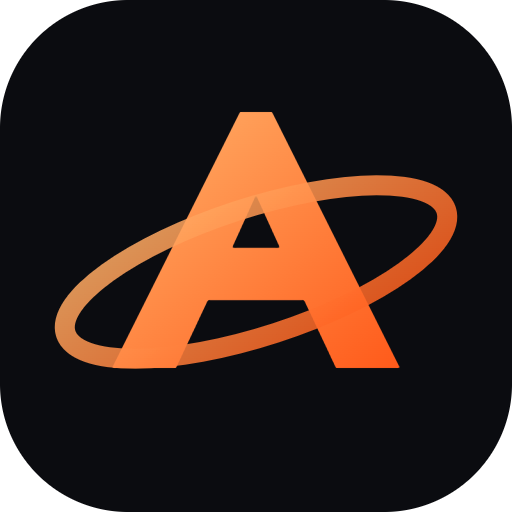
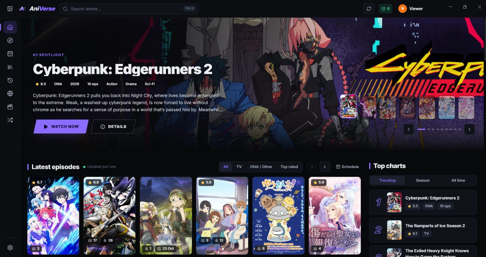

# AniVerse

**Your sites. Your collection. A calmer place to watch.**

A desktop browser with anime discovery, isolated website sessions, a native media player, and a local workspace.

[Download](https://github.com/shiwamshoryasharma/AniVerse/releases/latest) · [Getting started](#getting-started) · [Features](#version-211-features) · [Documentation](#documentation) · [Disclaimer](DISCLAIMER.md)

Windows 10 / 11 · Electron · React · TypeScript · GPL-3.0-or-later

## User-selected sources and content

AniVerse does not provide, endorse or control the sources users configure. Users are responsible for the sources they choose, the content they watch and ensuring they have permission to access it. The project does not grant content rights or permission to bypass a source’s restrictions. See [DISCLAIMER.md](DISCLAIMER.md).

## What AniVerse does

AniVerse brings the websites **you choose** and the media **you provide** into one desktop interface. Find a title through AniList, open a configured website in its own browser session, focus the site's existing player, and keep your progress alongside local scene notes and a watch plan.

The project does not operate a public episode-hosting service or internet stream relay. Official signed installers contain no streaming-site list. Adding a website does not establish that its content is licensed, and AniVerse does not grant permission to access or redistribute anyone else's work. Read the [disclaimer](DISCLAIMER.md) and [privacy notice](PRIVACY.md).

## Version 2.1.1 features

| Menu | What you can do |
| --- | --- |
| 🧭 **Home & Browse** | Discover titles with AniList in ALL; browse a selected website’s live catalogue in DUB/SUB. DUB includes mixed SUB/DUB series, including lagging dubs; SUB includes mixed and sub-only series. See source counts and turn pages without prior viewing. Explore includes an in-panel Audio selector, and shared hover cards show confirmed SUB/DUB tags with distinct unverified states. |
| 📅 **Schedule** | View episode air dates in your timezone and countdowns for unavailable releases. |
| 🛡️ **Source protection** | Embedded, bounded Rust/WebAssembly URL policy plus software/packaging safeguards. Normal player traffic remains direct. See [security boundaries and limits](docs/SECURITY-ARCHITECTURE.md). |
| 🌐 **Sources** | Configure websites or supported official YouTube channels. Each website has its own cookie/login session. |
| ▶️ **Watch** | Actual source episode stills when available, ALL/DUB/SUB episode filters, generic arc/season matching, automatic fallback across enabled sources, corrected player sizing, original website controls and Playback Rescue. |
| 🔒 **Private playback** | Temporary incognito sessions or persistent private-title rules. Suppress new watch records and future sync, with temporary website storage. See [privacy scope](PRIVACY.md). |
| 🪔 **Seasonal palette** | Diwali × Halloween dark colours through December 31, 2026; previous colours return automatically in January. Optional selection remains in Settings. |
| 🎬 **Player** | Open local videos or direct HLS/DASH/MP4/WebM URLs; use speed controls, fullscreen, picture in picture and supported casting. |
| 🔖 **Workspace → Scene bookmarks** | Save timestamps with private notes and tags; search, edit, delete or revisit a scene. |
| ✂️ **Episode Toolkit** | See bookmarks and intro/outro ranges on one episode timeline. Save a scene with **B** and build reusable skip maps. |
| 🛡️ **Spoiler Shield** | Hide app synopses and comments behind Reveal, plus future unwatched episode titles/thumbnails. |
| 💬 **Subtitle Studio** | Select two native-player caption tracks, adjust their offsets, style captions or import UTF-8 SRT/WebVTT files. |
| 🗓️ **Workspace → Weekly planner** | Fit available unwatched episodes from your library into a daily time budget over seven days. |
| 📁 **Workspace → Local collection** | Index video filenames, confirm title/episode matches and play files without relocating them. |
| 🖌️ **Settings → Interface themes** | Choose actual Classic, Studio or Cinema layouts; save/import/export visual presets. |
| ✨ **Anime4K Upscale** | GPU restore/denoise presets and optional line effects, plus compatibility capture for origin-blocked website players. |
| ☁️ **Settings → Google Drive sync** | Import/export app-data backups using your own Desktop OAuth JSON and a stable shared-folder format. |
| 📺 **4K casting** | Connect TVs found by Windows + K through the Windows wireless-display chooser, or use Google Cast with optional embedded sender-side Anime4K/HEVC 4K. |
| 🆕 **What’s new / Settings → Changelog** | See update highlights automatically and browse coloured release cards with icons inside the app. |
| 🎨 **Settings → Theme presets** | Save, apply, import and export visual preferences, including your UI font. |
| 📊 **Workspace → Watch insights** | Opt in to local playing-time estimates, title totals and observed dropped-frame ratios. |
| 🖥️ **Settings → Graphics & GPU** | Inspect GPUs and the active renderer; follow illustrated laptop setup and NVIDIA RTX Video guidance. |
| 🔄 **Library & Accounts** | Track list status, progress, favourites, history and scores; optionally sync with AniList/MyAnimeList. |

### A workspace built around the episode

The Episode Toolkit combines your notes, scene positions and skip ranges beneath the Watch player. Records remain local and separate from public comments and account list sync. This is a specific product workflow; the project makes no claim that its individual features are unprecedented.

Auto skip is off when saving a range unless you enable it. It runs only when the source matches and the runtime is close to the recorded edition. Website observation runs every three seconds, so skipping can lag the boundary. Check timing when changing cuts, releases or audio editions.

### Playback boundaries

- **Websites keep their own player.** AniVerse reads rendered search results and links, follows navigation, clicks exposed controls and focuses the original media area with CSS. It does not extract website streams into a replacement player.
- **SUB and DUB depend on the source.** AniVerse exposes options the site supplies; it does not synthesize a missing dub or translate audio.
- **Controls follow the observable video clock.** Native captions use the native video's clock. Website progress and rescue target the selected visible player/frame when accessible. Restricted or unusual players may limit controls.
- **Resync is a recovery attempt.** Frame counters help diagnose stalls, but do not prove lip sync. AniVerse cannot repair a badly encoded or mistimed source.
- **GPU preference is a request.** AniVerse requests high-performance graphics at startup and reports the active renderer. Windows, Chromium, power policy, drivers and codecs determine rendering and decoding paths.
- **RTX Video is driver controlled.** AniVerse does not install a custom driver, bundle an NVIDIA AI upscaler or guarantee super resolution, HDR or frame generation. Inspect the driver's own indicators.
- **Codec support varies.** Recognizing an extension does not prove Chromium can decode its codecs. Some MKV/MOV files will fail.
- **Dual captions stay inside AniVerse.** The overlay does not replace website captions or follow into operating-system picture in picture or a TV's player.

## Getting started

### 1. Install and verify

Download from [GitHub Releases](https://github.com/shiwamshoryasharma/AniVerse/releases/latest). Official installers use a self-signed project certificate; Windows may show an unverified publisher or SmartScreen warning.

Compare the installer signer with the [certificate fingerprints below](#installer-signing). A matching certificate identifies a signing key, not a guarantee of safety. Use a release you trust.

Updates appear in **Settings → About**, where automatic checks/downloads can be disabled. Upgrading preserves the local profile; back up important records before a major upgrade.

### 2. Add the sites you choose

Open **Settings → Sources → Edit streaming-sites.txt**, enter one URL per line, save and reload sources. Empty lines and hash-prefixed comments are ignored.

~~~text
# Illustrative address only: replace with a site you are authorized to use.
https://video.example.test
~~~

This deliberately non-operational address is not a recommendation. Site availability, access conditions and permissions remain independent of AniVerse.

Complete required sign-in or human verification in the site's browser view. Turn focus off if it hides a useful control. Popup and tracker blocking is best effort; filter lists cannot make every website quiet or trustworthy.

### 3. Find a title and watch

Search or browse, open a title, choose **Watch now**, then select a source and episode. Audio/server controls appear when supported by the site; some titles have only one audio version.

If playback stalls, try **Playback Rescue**, reload, reveal website controls or select another source you may use. Unreleased episodes normally show a release panel.

### 4. Keep an episode workspace

1. Start a video on the Watch page.
2. Enter a note and comma-separated tags in **Episode Toolkit**, then **Save scene**. **B** also saves a scene when the app has keyboard focus and you are not typing in a field.
3. In **Intro & outro map**, set start/end seconds using the current-position buttons. Check the range before explicitly enabling Auto skip.
4. Open **Workspace → Scene bookmarks** to search or edit notes and revisit timestamps. Positions can differ across editions.

### 5. Open local videos and captions

1. Choose **Workspace → Local collection → Choose folder**.
2. Select **Match title**, search AniList and confirm the title and episode. Filename guesses are suggestions, not identity guarantees.
3. Select **Play**. Matched videos open on Watch; unmatched videos open in Player.
4. In the native player's **Subtitle Studio**, choose two tracks or import SRT/VTT. Positive offsets delay captions. **Save style** keeps the primary offset, size, colour and background.

A scan covers up to 2,000 videos and six nested folder levels; symbolic links are skipped. Refresh after moving files. Removing an entry removes the index record, not its video. Playback requires a Chromium-supported codec.

### 6. Plan and personalize

Add titles to Watching, Planning or Rewatching, then build a week in **Weekly planner**. It uses up to 20 library titles and known airing data. Missing runtimes use a labelled 24-minute estimate. Rebuild after changing progress or list entries.

Choose font, accent, density and motion under **Settings → Profile & appearance**. Save the result in **Theme presets**. Preset JSON includes only approved visual/player preferences; account data, sources, notes and private filesystem paths are excluded.

Watch insights start disabled. Enable them explicitly if wanted and clear stored samples from the same menu.

### 7. Optional account sync

Configure your own OAuth client IDs following [Accounts](docs/ACCOUNTS.md). Do not put secrets in frontend code or committed configuration. Without client IDs, browsing, discovery and the local library still work.

Sign-in uses the provider's official page in your system browser. Tokens stay in the main process. Local notes, collection paths, skip maps and plans are excluded from AniList/MAL list sync. Manual [Google Drive backup](docs/GOOGLE-DRIVE.md) can include notes, skip maps and plans, with credentials and device-specific paths excluded.

### 8. Google Drive and 4K

Use **Settings → Google Drive sync** to upload your own **Desktop app OAuth JSON**, connect Google and export/import app data. Keep **AniVerse Sync/aniverse-backup.v1.json** unchanged. See [Drive setup and shared folders](docs/GOOGLE-DRIVE.md).

Choose **Settings → Player → Anime4K** or the native player's **4K** control for GPU upscaling. For sender-side TV processing, open a local video, open Cast and enable **4K · process on this device**. The bundled encoder produces HEVC 4K; a compatible receiver, Vulkan-capable sender and adequate network are required. [Playback details](docs/PLAYBACK.md).

## Privacy and trust

AniVerse has no developer-operated usage-analytics endpoint. Opt-in watch insights are computed locally. Browsing still involves networking: websites, metadata/image providers, filter-list distributors and the release host receive their own requests.

The local profile contains library records, settings, notes, plans, collection paths and browser sessions. Menus show local filenames instead of your private system paths; the database itself is not an encrypted vault. Cookies and cache can contain information from visited sites.

See [PRIVACY.md](PRIVACY.md) for destinations, retention and deletion. Do not attach a full database, cookies, credentials, private source lists or personal paths to a public report.

## Copyright and project support

The application does not own third-party videos, subtitles, artwork or catalogue text. Its open-source license does not license that media. Contact a website's operator/host about material they control. Concerns about this repository's code/assets can be raised with the project; GitHub's formal copyright process remains available. The [disclaimer](DISCLAIMER.md) does not reject valid notices or establish legal immunity.

AniVerse is a personal project shared on a best-effort basis. Updates may be rare; there is no fixed roadmap, service-level agreement, support response time or promise of lasting website compatibility.

## Build from source

Use Windows 10/11, Node.js 22 or newer, npm, Git and Rust/Cargo 1.93 or newer. Install the Rust WebAssembly target with `rustup target add wasm32-unknown-unknown` before development, tests or builds. The embedded policy is compiled automatically; application users do not need Rust. Storage uses the runtime's built-in SQLite.

~~~powershell
git clone https://github.com/shiwamshoryasharma/AniVerse.git
cd AniVerse
npm ci
npm run dev
~~~

For a production build:

~~~powershell
npm run typecheck
npm run lint
npm test
npm run build
npm start
~~~

| Command | Purpose |
| --- | --- |
| npm run dev | Renderer hot reload and main-process rebuilds |
| npm run build | Bundle main/preload and the React renderer |
| npm test | Unit and persistence regressions |
| npm run test:e2e | Existing hidden Electron smoke harness |
| node test/e2e/workspace.mjs | Version 1 Workspace and native-player regressions after building |
| npm run dist:installer | Build a Windows installer from this checkout |
| npm run dist:signed | Signed release installer, blockmap and update feed |
| node scripts/release.mjs --notes docs/releases/1.0.0.md | Maintainer publishing: tags, pushes and uploads a prepared signed release |

Personal builds may copy local configuration from the checkout. Official signed builds use restricted resources and omit private source lists/recipes. Forks need their own signing identity; private signing material must remain private.

All test scripts, profiles, caches, temporary files and evidence belong under **test/**. Image-based model checks, where applicable, use inputs in **test/images/**. See [test/README.md](test/README.md) and [agent guidance](AGENTS.md).

~~~text
app/shared/       Types, RPC contracts, playback/subtitle/theme helpers
app/core/         SQLite, settings, library, metadata, sources, workspace
electron/         Windows, sessions, IPC, navigation, GPU, local media
frontend/         React pages, components, native player and CSS
config/           Public examples/filters; private configuration stays local
scripts/          Build, signing and release tools
test/             Tests, fixtures, isolated caches and generated evidence
docs/             Architecture, accounts, installer, updater, releases
.codex/           Project skills and engineering memory
~~~

## Installer signing

Official installers use **CN=Shiwam Shorya Sharma, O=AniVerse**.

**Certificate SHA-1**

~~~text
5A:AD:69:1D:2F:1B:3C:A4:80:BA:10:83:D4:17:E7:2D:FA:9F:2B:84
~~~

**Certificate SHA-256**

~~~text
A4:E9:77:36:B3:50:B8:DB:5D:71:A7:A6:0B:D2:AA:94:BE:AA:8D:70:FB:0F:19:E2:27:D9:BF:3C:36:81:41:45
~~~

Inspect **Properties → Digital Signatures → Details → View Certificate**. From your download directory, PowerShell 7 can print the fingerprints:

~~~powershell
$certificate = (Get-AuthenticodeSignature -LiteralPath '.\AniVerse-Setup-1.5.6.exe').SignerCertificate
if ($null -eq $certificate) { throw 'No signer certificate found.' }
$certificate.Thumbprint
[Convert]::ToHexString([Security.Cryptography.SHA256]::HashData($certificate.RawData))
~~~

The certificate is self-signed, not publicly trusted. Compare fingerprints and release checksums using trusted project information. Do not bypass a mismatch.

## Documentation

| Document | Scope |
| --- | --- |
| [Architecture](docs/ARCHITECTURE.md) | Layers, data flow and trust boundaries |
| [Accounts](docs/ACCOUNTS.md) | OAuth and list sync |
| [Google Drive](docs/GOOGLE-DRIVE.md) | Personal OAuth JSON, portable backups and shared folders |
| [Third-party components](docs/THIRD-PARTY.md) | Embedded FFmpeg/FFprobe and Anime4K source/license information |
| [Installer](docs/INSTALLER.md) · [Updates](docs/UPDATES.md) | Installation, feed, signatures and publishing |
| [Version 1 notes](docs/releases/1.0.0.md) | Changes, checks and known limits |
| [Disclaimer](DISCLAIMER.md) · [Privacy](PRIVACY.md) | Rights, product scope, local data and notices |
| [Contributing](CONTRIBUTING.md) · [Security](SECURITY.md) | Contribution checks and vulnerability reporting |

## Contributing

Reports and pull requests are welcome under [CONTRIBUTING.md](CONTRIBUTING.md). Share reproducible behavior without credentials, copyrighted video copies or private site lists.

 

<h2 align="center">License</h2>

  

You may use, copy, distribute and modify AniVerse under **[GPL-3.0-or-later](LICENSE)**. When distributing covered modifications, preserve copyright and license notices, clearly identify changes and their dates, and license the covered work under the GPL. When distributing covered binaries, meet the license's Corresponding Source requirements, including build/install scripts and installation information where required. Dependencies retain their own terms. The software is provided without warranty as described in the license, subject to applicable law.

© 2026 Shiwam Shorya Sharma.

 

<h2 align="center">DMCA disclaimer</h2>

AniVerse is a desktop web browser and media player. The project does not operate a public episode-hosting service or supply third-party videos. Websites and their media load from the sources users choose; local files remain on the user's device. The project is not affiliated with those websites, and videos, subtitles, artwork and other materials retain their owners' rights.

For a takedown request concerning content hosted on another website, contact that website's operator or hosting provider. Concerns about this repository's own code or assets can be raised through the project and [GitHub's formal copyright process](https://docs.github.com/en/site-policy/content-removal-policies/dmca-takedown-policy). This notice does not waive valid legal obligations or grant permission to use copyrighted material.

  <a href="DISCLAIMER.md">Full disclaimer</a> · <a href="PRIVACY.md">Privacy notice</a>

